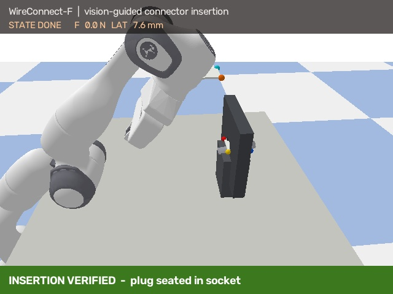
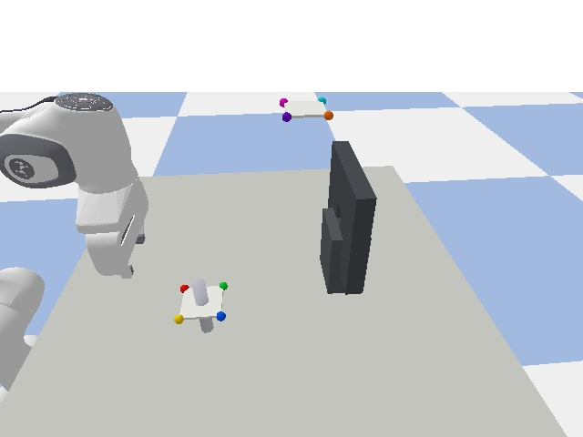
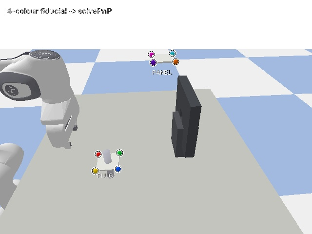

# WireConnect-F

**视觉引导的线缆/连接器自主插入 · Franka + PyBullet 数字孪生**

> WireConnect-F is a runnable Franka/PyBullet digital twin of a cable-connector insertion task that combines monocular fiducial pose estimation, grasp alignment, and force-monitored spiral insertion, achieving 90% success across 20 randomized simulation trials.

参照 [`SY1777/TianY2.0_wireconnect`](https://github.com/SY1777/TianY2.0_wireconnect)（人形 + 灵巧手 · 线缆连接赛道）的思路，把任务拆成桌面级、可复现的 Franka 实验：**抓取插头 → 视觉对准 → 插入 → 验证 → 失败恢复**。



## 场景与感知

| 初始场景 | 四色 fiducial 检测 |
|---|---|
|  |  |

## 结果（20 次随机化试验）

| 指标 | 结果 |
|---|---|
| 插入成功率 | **18/20 = 90%** |
| 抓取成功率 | 20/20 |
| 感知成功率 | 20/20 |
| 平均横向误差 | 6.5 mm（最大 9.5 mm） |
| 平均单次仿真耗时 | ~0.6 s（不含渲染/编码） |
| 失败类型 | `insert_stuck` × 1、`insert_timeout` × 1 |

- 演示视频：`media/demo.mp4`（约 21 s，结尾有 socket 特写）
- 原始数据：`media/trials.csv`
- 复现命令：`python scripts/evaluate.py 20`

## 任务与场景

- **机器人**：Franka Panda + 平行夹爪（PyBullet 内置 URDF）
- **插头**：Ø18 mm × 100 mm 圆柱，水平放置在支架上
- **插座**：面板上的 34 mm 方孔（盲插容错），孔深 30 mm
- **相机**：固定俯视 RGB 相机（640×480），单目
- **感知**：每帧检测两组四色 fiducial（插头 / 面板），PnP 求 6D 位姿
- **控制**：7-DoF IK + 位置控制；插入阶段 1.5 mm 步进 + 横向闭环 + 卡滞回退
- **验证**：插头尖端进入孔内 + 横向误差 < 10 mm；成功后 latch 并输出特写

## 快速开始

```bash
# 需要 Python 3.10+（本机为 3.14，PyBullet 从源码构建成功）
python3 -m venv --system-site-packages .venv
.venv/bin/pip install -r requirements.txt

.venv/bin/python scripts/run_one.py      # 单次 episode，打印状态
.venv/bin/python scripts/demo.py         # 生成 media/demo.mp4 + demo_still.jpg
.venv/bin/python scripts/evaluate.py 20  # 20 次随机试验 -> media/trials.csv
```

依赖：`numpy`、`pybullet`、`opencv-python-headless`。

## 系统结构

```
RGB camera
   │
   ▼
ColorFiducialDetector ──► plug pose / socket pose (PnP)
   │
   ▼
WireConnectTask (state machine)
   IDLE → PERCEIVE → GRASP → LIFT → ALIGN → INSERT → VERIFY → DONE
                                      │
                                      ├─ force > 10 N → retreat + spiral
                                      └─ stuck → retry (≤ 4)
   │
   ▼
PandaRobot (IK + joint position control + gripper)
   │
   ▼
PyBullet (Franka, table, panel, plug, contact)
```

| 文件 | 作用 |
|---|---|
| `src/wireconnect/scene.py` | 场景、面板/插座、插头、fiducial、相机、接触力、latch |
| `src/wireconnect/robot.py` | Franka IK、关节运动、夹爪 |
| `src/wireconnect/perception.py` | 四色 fiducial 检测 + `solvePnP` + 相机→世界变换 |
| `src/wireconnect/task.py` | 状态机、抓取、插入、回退、episode 结果 |
| `src/wireconnect/utils.py` | 旋转/相机/几何工具 |
| `scripts/demo.py` | 录制演示视频（叠加状态/力/横向误差） |
| `scripts/evaluate.py` | 随机化批量试验 + CSV |
| `media/` | 视频、截图、试验数据 |

## 关键设计

1. **单目 PnP 求标记位姿**：检测四色球在图像中的像素质心，`solvePnP` 求标记位姿，再用相机外参变到世界。真实机器人上把检测器换成 `cv2.aruco` / YOLO 即可。
   - 注意：抓取高度使用固定工装示教值，插座使用示教位姿（`use_taught_socket=True`）；插入的横向闭环读取仿真插头位姿。真机上分别替换为工装标定、固定工位标定、腕部相机/抓取运动学估计。
2. **先粗对准，再接触搜索**：预插入位姿在孔前 2.5 cm，横向闭环对齐到 <2 mm，然后 1.5 mm/步进给；力超阈值就回退 + 螺旋搜索。
3. **抓取用"接触检测 + 刚性 assist"**：PyBullet 的平行夹爪夹圆柱时摩擦不稳定；代码先确认指爪接触，再用固定约束把插头刚性连接到 TCP。真实机器人上对应"夹紧 + 摩擦"，任务层只依赖 `grasp_ok`。
4. **固定工位示教**：`use_taught_socket=True` 时使用示教的插座位姿（面板固定）；`False` 时完全用视觉估计（成功率会下降）。
5. **失败可诊断**：每次试验记录 `max_force / retries / lateral / failure`，失败分为 `grasp_failed / insert_stuck / insert_timeout`。

## 已知简化（不要当成比赛级方案）

- 仿真里的 fiducial 是**四色球**，因为 PyBullet TinyRenderer 不渲染纹理；真实场景用 ArUco/YOLO。
- 插头标记是**视觉专用**、每步 teleport，不参与物理。
- 抓取是**刚性 assist**，不是真实摩擦夹持；真实机器人需要夹爪力控/软指垫。
- 插座 34 mm 方孔、插头 18 mm，容错偏大；真实连接器间隙通常 <1 mm，需要更精细的视觉/力控。
- 力上限未做硬约束；某次卡滞重试里峰值到 ~57 N，真机必须加力限/急停。
- 插入横向闭环读取仿真插头位姿（ground truth），不是纯视觉；真机需换成腕部相机或 TCP+已知抓取偏移。
- 这是**桌面数字孪生 MVP**，不是人形/灵巧手竞赛方案；算法层可迁移。

## 从 WireConnect 学到的

1. 只靠单目 + 贴纸/YOLO 不够稳，必须加标定、深度或力反馈兜底。
2. "空间站对接"式插入（粗对准 → 接触 → 旋转/螺旋搜索）比纯视觉硬怼可靠。
3. 赛前一周才收尾 = 高风险；真机时间要占 1/3 以上。
4. 文档、测试工具、失败日志是可复现性的核心。
5. 硬件（夹具、相机支架、线缆固定）会吃掉大量时间，提前做。

## 迁移到 ROS2 / Gazebo / MoveIt2

| 本仓库 | ROS2 对应 |
|---|---|
| `scene.py` | Gazebo + `franka_description` |
| `robot.py` IK/关节控制 | `moveit2` + `franka_ros2` / `ros2_control` |
| `perception.py` | `aruco_ros` / `realsense2_camera` / YOLO 节点 |
| `task.py` | lifecycle node 或 behavior tree |
| `evaluate.py` | `rosbag2` + CSV/plot |

当前环境没有 ROS2/Gazebo，所以用 PyBullet 做**算法层验证**；接口已按"感知→状态机→机器人"分层，替换仿真后端不影响任务代码。

## Roadmap

- [ ] ArUco/YOLO 检测 + 腕部相机
- [ ] 力限/阻抗控制，替换位置控制插入
- [ ] 更小间隙（<2 mm）+ 柔性线缆
- [ ] ROS2/Gazebo 移植
- [ ] 100 次试验 + 消融（有无闭环对齐/有无螺旋）
- [ ] 真实 Franka 迁移

## 参考

- WireConnect: https://github.com/SY1777/TianY2.0_wireconnect
- PyBullet: https://pybullet.org/
- OpenCV PnP: https://docs.opencv.org/4.x/d5/dae/tutorial_aruco_detection.html
